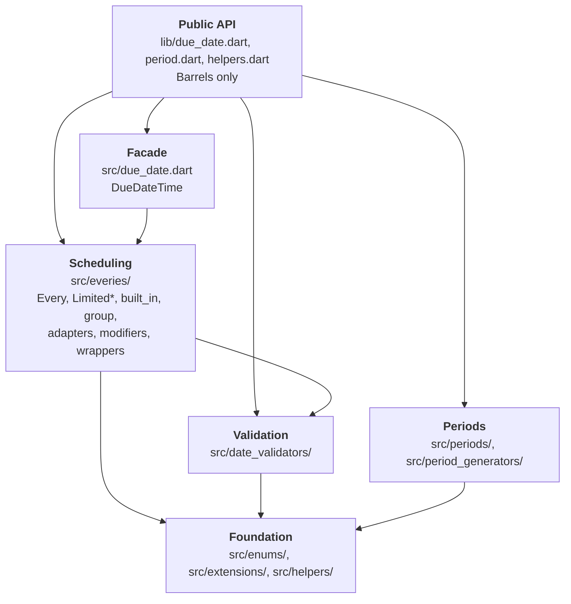

# Architecture

This document defines the layers of `due_date`, the direction dependencies are
allowed to flow, and where new code belongs. It is the project's source of
truth for layer boundaries: where it disagrees with the generic
`layered-architecture` skill, this document wins.

`due_date` is a pure-Dart library. It has no UI, no I/O and no persistence, so
the usual View → Controller → Service → Repository → Data Source stack does not
apply. The whole package is the **domain core** that a consuming app's Service
layer calls into. There are no ViewModels, and none should be added.

## Non-goals

- Depending on Flutter or `dart:io`.
- Storing, serializing or formatting anything.
- Localization.

Runtime dependencies are limited to `clock`, `collection`, `equatable`, `meta`
and `time`. Anything beyond that needs a deliberate decision recorded here.

## Layers

Dependencies flow **downward only**: a layer may import from the layers below
it, never from the layers above it.

| Layer | Path | Does | Must not |
|---|---|---|---|
| Public API | `lib/*.dart` | Export the public surface; carry library-level docs | Declare logic |
| Facade | `src/due_date.dart` | `DueDateTime`: compose an `Every` with a date and expose `next`/`previous`/etc. | Be imported by any lower layer |
| Scheduling | `src/everies/` | Produce the next/previous date for a rule; limits, adapters, modifiers, wrappers, groups | Know about `DueDateTime` |
| Validation | `src/date_validators/` | Answer "is this date valid?" and combine validators (union, intersection, difference, opposite) | Generate dates |
| Periods | `src/periods/`, `src/period_generators/` | `Period` math and generators | Import Scheduling or Validation |
| Foundation | `src/enums/`, `src/extensions/`, `src/helpers/` | `Weekday`, `Month`, `Week`, `DateTime` extensions, small utilities | Import the Facade |

`periods/` and `period_generators/` form one module. They reference each other
by design (`Period` exposes its generator, each generator builds its period).
The Periods module is independent of Scheduling and Validation, and that
independence is a rule.

## Dependency rules

1. **No upward imports.** A lower layer never imports a higher one.
2. **The Facade is a root.** Nothing under `src/` other than the barrels
   imports `src/due_date.dart`.
3. **Periods stays a sibling.** `periods/` and `period_generators/` never import
   `everies/` or `date_validators/`.
4. **Barrels declare, `src/` implements.** Files in `lib/` contain only
   `import`, `export` and library docs.
5. **Cycles are not allowed**, except the ones listed under
   [Known exceptions](#known-exceptions-scheduled-for-removal).

## Known exceptions (scheduled for removal)

These edges break the rules above today. They are existing debt that the
project is working to remove, not accepted design. The list is a **baseline
that may only shrink**:

- Do not add a new edge of the same kind as an excuse.
- When an exception is fixed, delete its row and update the dependency graph.
- A new violation that is not on this list is a finding, not an exception.

| ID | Edge (from → to) | Files | Why it exists today | Removal direction (proposed) |
|---|---|---|---|---|
| E1 | Validation → Scheduling | `date_validators/built_in/date_validator_weekday.dart`, `date_validators/built_in/date_validator_due_workday_month.dart` | Built-in validators construct `EveryWeekday` / `EveryDateValidatorUnion` for their `workdays`/`weekend` constants and `_workdays` | Express those constants without `Every*`, or move them to the layer that owns `Every*` |
| E2 | Foundation → Scheduling / Validation | `helpers/workday_helper.dart`, `helpers/limited_or_every_handler.dart` | Both helpers are written in terms of `EveryWeekday`, `Every`, `LimitedEvery` and `DateValidator` | Re-home them in Scheduling, since that is what they are |
| E3 | Foundation → Scheduling | `enums/weekday.dart`, `enums/weekday_occurrence.dart` | `Weekday.every` returns an `EveryWeekday`; `WeekdayOccurrence` wraps `EveryWeekdayCountInMonth` | Move the convenience factories to extensions in Scheduling |
| E4 | Foundation → Validation | `enums/weekday.dart`, `enums/weekday_occurrence.dart` | `Weekday` and `WeekdayOccurrence` use `DateValidatorWeekday` / `DateValidatorMixin` | Same as E3 |
| E5 | Foundation → Periods | `enums/week.dart`, `enums/month.dart`, `enums/weekday.dart`, `enums/period_generator.dart` | Enums expose `WeekPeriod` / `MonthPeriod` / generators as conveniences; `PeriodGenerator` is a registry of every generator | `PeriodGenerator` is arguably a Periods-layer type that lives in `enums/`; the rest are convenience factories like E3 |
| E6 | Foundation → Facade | `extensions/clamp_in_month.dart` imports `src/due_date.dart` | The `dueDateTime` getter on `DateTime` builds a `DueDateTime` | Move the getter next to `DueDateTime`, or into a Facade-level extension |
| E7 | Scheduling ⇄ Foundation (cycle) | `everies/*` ↔ `helpers/*` (19 edges in, 6 out) | Consequence of E2 | Resolves with E2 |
| E8 | Scheduling ⇄ Validation (cycle) | `everies/*` ↔ `date_validators/*` (39 edges in, 4 out) | `EveryDateValidator` mixes in `DateValidatorMixin`; consequence of E1 | Resolves with E1 |
| E9 | Foundation → Periods → Foundation (cycle) | `enums/*` ↔ `periods/*` | Consequence of E5 | Resolves with E5 |

The edge counts were taken at file level from `import`/`export` lines in
`lib/src` and are indicative, not analyzer-verified.

Most of the exceptions come from a few causes: **convenience factories placed
on enums** (E3, E4, E5, E9), **helpers that are really Scheduling code**
(E2, E7), and **built-in validators built from `Every*` constants** (E1, E8).
The only exception unrelated to those is E6, a single upward edge.

## Extension model

Scheduling is the main extension point.

- `Every` is the base class. Mix in `EveryWeek`, `EveryMonth` or `EveryYear` to
  say how `next`/`previous` step. Mix-in order matters: the last one wins.
- `EveryDateValidator` is an `Every` that is also a `DateValidator`.
- Adapters, modifiers and wrappers decorate or compose an existing `Every`
  (`everies/adapters/`, `everies/modifiers/`, `everies/wrappers/`).
- `Limited*` types are a parallel hierarchy that adds a `limit` argument. A new
  capability usually needs both variants and a test for each.
- `group/` holds union, intersection and difference of validators or everies.

Prefer adding to an existing extension point over adding a new base type.

## Purity and public API

- Domain types are immutable: `@immutable`, `final` fields, `const`
  constructors wherever possible.
- The current time comes from `package:clock`, never from `DateTime.now()`
  directly, so tests can control it.
- Every public declaration under `src/` is exported from `lib/`
  (`test/_structural/export_api_test.dart` enforces this).
- `lib/helpers.dart` is exported for exploration only and stays `@Deprecated`.
  Do not move something there to make it public.
- Every public member has a `///` doc comment (`public_member_api_docs`).

## Where does new code go?

Ask top-down, and stop at the first yes:

1. *A new way to express "the next/previous date matching a rule"?* → Scheduling
   (`everies/`), plus its `Limited*` variant if the rule can be bounded.
2. *A new "is this date valid?" predicate?* → Validation (`date_validators/`).
3. *A new unit of time, or period math?* → Periods.
4. *A reusable primitive (enum, `DateTime` extension, small utility) that
   knows nothing about rules?* → Foundation.
5. *A convenience on `DueDateTime` itself?* → Facade.
6. *A new public symbol?* → Also export it from the matching `lib/*.dart`
   barrel.

If a new member does not clearly fit exactly one layer, it is doing two jobs:
split it. A change touches only the layers whose behavior changes; do not add
pass-through methods just to "go through" every layer.

## Enforcement

Today the boundaries are held by review and by the `architecture-guardian`
agent reading this document. Nothing in CI checks import direction yet.

The proposed next step, deliberately not part of this document's first
version, is a `test/_structural/layering_test.dart` next to the existing
`export_api_test.dart`. It would fail on any import edge that is neither allowed
by the dependency rules nor listed in the exceptions table above, which makes
the baseline mechanical instead of honor-based.
