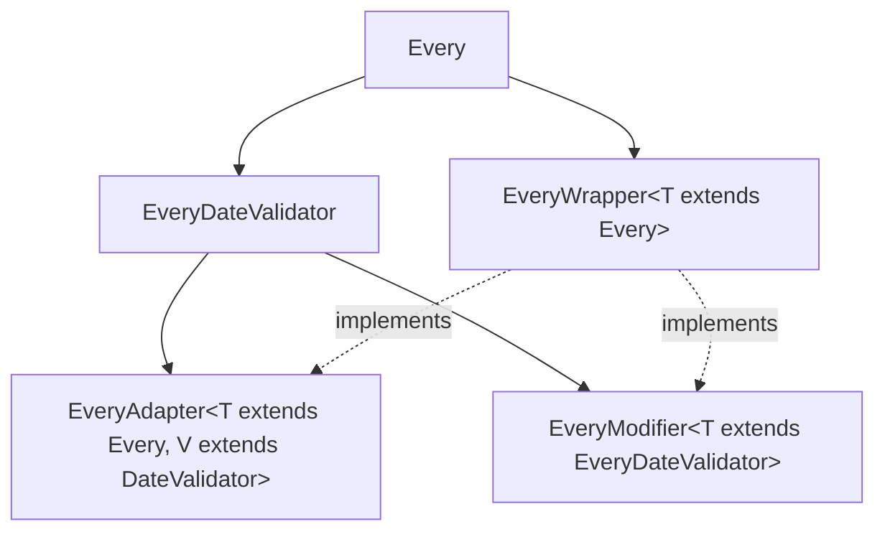

# Architecture

This document defines the layers of `due_date` and where new code belongs. It
is the project's source of truth for layer boundaries: where it disagrees with
the generic `layered-architecture` skill, this document wins.

`due_date` is a pure-Dart library. It has no UI, no I/O and no persistence, so
the usual View → Controller → Service → Repository → Data Source stack does not
apply. The whole package is the **domain core** that a consuming app's Service
layer calls into. There are no ViewModels, and none should be added.

## Non-goals

- Depending on Flutter or `dart:io`.
- Storing, serializing or formatting anything.
- Localization.

## Dependencies

Runtime dependencies are limited to `clock`, `collection`, `equatable`,
`essential_lints_annotations`, `meta` and `time`. Anything beyond that needs a
deliberate decision recorded here.

`essential_lints_annotations` carries no runtime behavior — it supplies the
annotations (`@SubtypeNaming`) that the `essential_lints` analyzer plugin
configured in `analysis_options.yaml` reads. It is a `dependency` rather than a
`dev_dependency` because those annotations appear in public API files under
`lib/src/everies/`.

## Layers

Layers describe **what code is responsible for and where it lives**, not who
may import whom. The types here are abstract so they can be composed, and any
layer may import any other: an enum may hand out its `Every`, a validator may
be built from `Every*` constants, and a module pair may reference each other.
Do not restructure code only to change the direction of an import.

| Layer | Path | Does | Must not |
| --- | --- | --- | --- |
| Public API | `lib/*.dart` | Export the public surface; carry library-level docs | Declare anything of its own |
| Facade | `src/due_date.dart` | `DueDateTime`: compose an `Every` with a date and expose `next`/`previous`/etc. | Hold scheduling rules of its own; it delegates to `Every` |
| Scheduling | `src/everies/` | Produce the next/previous date for a rule; limits, adapters, modifiers, wrappers, groups | |
| Validation | `src/date_validators/` | Answer "is this date valid?" and combine validators (union, intersection, difference, opposite) | Generate dates |
| Periods | `src/periods/`, `src/period_generators/` | `Period` math and generators | |
| Foundation | `src/enums/`, `src/extensions/`, `src/helpers/` | `Weekday`, `Month`, `Week`, `DateTime` extensions, small utilities | |

`periods/` and `period_generators/` form one module (`Period` exposes its
generator, each generator builds its period). It has no barrel of its own;
`lib/period.dart` lists its files individually, which is the target for every
module (see [Barrels](#barrels)).

## Barrels

The `.dart` files directly in `lib/` contain only `import`, `export` and
library docs, and they are the only barrels: they export each `src/` file
directly, and nothing under `src/` is a barrel. Code under `src/` never
imports a barrel — neither a `lib/*.dart` file nor one of the `src/` barrels
below — and always imports the file that declares what it needs. `src/` still
has export-only barrels today, scheduled for removal (no new ones may be
added):
`everies/everies.dart`, `date_validators/date_validators.dart`,
`extensions/extensions.dart`, and the nested `built_in.dart` and `group.dart`
(one each under `everies/` and `date_validators/`), `adapters.dart`,
`modifiers.dart` and `wrappers.dart`, ten in all. Only the `lib/` barrels use
them, so removing them means those barrels list the files individually; no
`src/` import changes. `lib/` also holds non-Dart tooling data —
`lib/fix_data/`, currently `fix_date_validator.yaml` — which this rule does not
cover.

## Extension model

Scheduling is the main extension point.

- `Every` is the base class, with `next` and `previous`. Mix in `EveryWeek`,
  `EveryMonth` or `EveryYear` to say how those step. Mix-in order matters: the
  last one wins.
- `EveryDateValidator` is an `Every` that is also a `DateValidator`.
- `Limited*` types are a parallel hierarchy whose `next`/`previous` take an
  extra `{DateTime? limit}` named parameter and throw
  `DateTimeLimitReachedException` once a generated date passes it;
  `LimitedEvery` also adds `throwIfLimitReached`. A new capability usually needs
  both variants and a test for each.
- `group/` holds union, intersection and difference of validators or everies.

Wrappers, modifiers and adapters (`everies/wrappers/`, `everies/modifiers/`,
`everies/adapters/`) all decorate an existing `Every`, but they are **not
siblings**:

`EveryWrapper` is the base interface that the other two implement. The
normative rule for choosing between them is the "Every, Wrappers, Modifiers,
and Adapters" section of [README.md](README.md): a **wrapper** changes
iteration only, a **modifier** changes iteration and validation on an
`EveryDateValidator`, and an **adapter** bridges an `Every` to a
`DateValidator`. Prefer the adapter direction for anything that reaches into
validation — 3.0.0 removed `EveryOverrideWrapper`, `EveryModifierInvalidator`
and `EverySkipInvalidModifier` in favor of adapter equivalents.

Prefer adding to an existing extension point over adding a new base type.

## Purity and public API

- Domain types are immutable: `final` fields and `const` constructors
  throughout. `@immutable` is applied at the root of each hierarchy — `Every`,
  `DateValidator`, `ExactDateValidator`, `Period`, `PeriodGeneratorMixin` and
  `DueDateTime` — and inherited from there rather than repeated on subtypes.
- No code under `lib/` calls `DateTime.now()`. `DueDateTime` is the only type
  that reads a clock at all, and it does so through `package:clock` so tests
  can control it; everything else takes the dates it works on as parameters.
- Every public declaration under `src/` is exported from `lib/`
  (`test/_structural/export_api_test.dart` enforces this).
- `lib/helpers.dart` is exported for exploration only and stays `@Deprecated`.
  Do not move something there to make it public.
- Every public member has a `///` doc comment (`public_member_api_docs`, set in
  `analysis_options.yaml`).

## Where does new code go?

Ask top-down, and stop at the first yes:

1. *A new way to express "the next/previous date matching a rule"?* → Scheduling
   (`everies/`), plus its `Limited*` variant if the rule can be bounded.
2. *A new "is this date valid?" predicate?* → Validation (`date_validators/`).
3. *A new unit of time, or period math?* → Periods.
4. *A reusable primitive (enum, `DateTime` extension, small utility) that
   knows nothing about rules?* → Foundation.
5. *A convenience on `DueDateTime` itself?* → Facade.
6. *A new public symbol?* → Also export it from the matching `lib/*.dart`
   barrel.

If a new member does not clearly fit exactly one layer, it is doing two jobs:
split it. A change touches only the layers whose behavior changes; do not add
pass-through methods just to "go through" every layer.

## Enforcement

The boundaries are held by review and by the `architecture-guardian` agent
reading this document. `test/_structural/export_api_test.dart` checks that
every public declaration under `src/` is exported from `lib/`.
